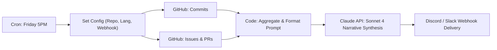

# n8n + Claude Code: Automated Weekly Dev Summary

> A production-ready, exportable n8n workflow that automatically compiles GitHub activity (commits, closed issues, merged PRs) for the week, synthesizes an executive engineering narrative using the Anthropic Claude API (`claude-sonnet-4-20250514`), and dispatches it directly to Discord or Slack.

---

## 🏗️ Workflow Architecture



---

## ⚡ 5-Step Setup Instructions

1. **Import Workflow**:
   In your n8n canvas, click **Add Workflow** ➔ **Import from File** and select [`weekly-dev-summary.json`](weekly-dev-summary.json).

2. **Set Claude API Key**:
   Set `ANTHROPIC_API_KEY` in your n8n environment variables, or enter your Anthropic API Key in the `Call Claude API` HTTP node header (`x-api-key`).

3. **Configure Your Target Repository**:
   Open the **Configuration Variables** node and set:
   - `GITHUB_REPO`: `your-organization/your-repo`
   - `LANGUAGE`: `EN` or `FR` (English / Français)
   - `DISCORD_WEBHOOK_URL`: Your Discord/Slack webhook URL

4. **Test Run**:
   Click **Test step** or **Execute workflow** to verify the end-to-end pipeline and preview the narrative dev summary in your chat channel.

5. **Activate**:
   Toggle the workflow to **Active**. The cron schedule triggers every Friday at 5:00 PM UTC (`0 17 * * 5`).

---

## 🌟 Example Narrative Output

```text
📢 Weekly Dev Summary for owner/repo

🌟 Highlights & Major Milestones
This week the team focused on core infrastructure stability and autonomous agent integrations, shipping 18 pull requests with zero regressions.

🚀 Key Features Delivered
- Automated PR Reviewer Agent with static risk analysis heuristics
- PreToolUse security hook intercepting dangerous bash commands
- Base L2 USDC x402 payment gateway documentation

🐛 Bug Fixes & Refactoring
- Resolved WAL journal synchronization under concurrent worker processes
- Hardened typed_data EIP-712 challenge verification

📈 Velocity & Contributor Kudos
Special shoutout to @criptobot25 and the core contributors for leading this week's rapid release cycle!
```
